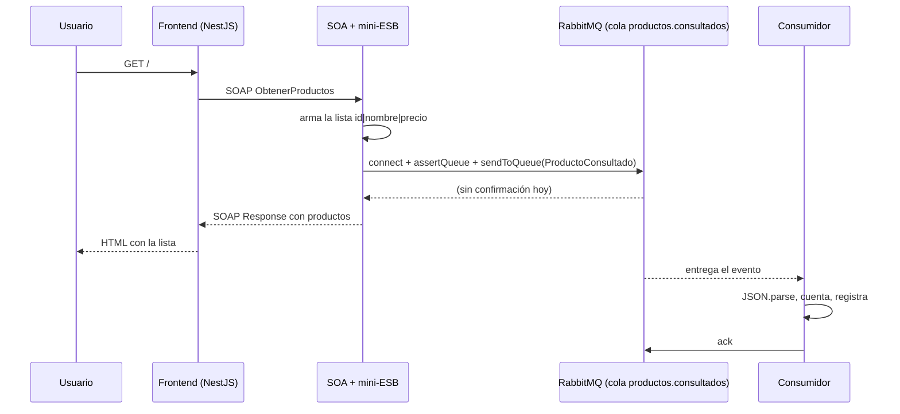

# Auditoría técnica del backend: SOA + ESB + RabbitMQ

- **Proyecto:** `soa-eventos-rabbitmq` (Reto 1, Integración de Sistemas, Semana 5)
- **Autora del sistema:** Alisson Basantes
- **Tipo de auditoría:** integral y **no destructiva** (secciones 1 a 6: se leyó el código y se consultaron las URLs públicas, sin modificar nada). Las correcciones posteriores están registradas en la sección 7.
- **Alcance:** `soa-productos-service`, `consumidor-eventos`, `frontend-mvc`, contratos (`productos.wsdl`, `contrato.yaml`) y despliegue (Render + CloudAMQP).
- **Regla del informe:** cada hallazgo cita archivo y línea del código real. Lo que se infiere y no se pudo ejecutar se marca como *inferido* y tiene su prueba en la sección 5. Lo que cumple el estándar se indica como tal.

---

## 1. Resumen ejecutivo

**Qué es.** Un sistema de cuatro piezas en un solo flujo: un frontend NestJS llama por SOAP a un servicio SOA; el servicio, mediante una capa mini-ESB (`evento-publisher.js`), publica el evento `ProductoConsultado` en una cola de RabbitMQ; un consumidor independiente lee ese evento.

```
Frontend MVC --SOAP--> SOA + mini-ESB --evento--> RabbitMQ --> Consumidor
```

**Estado de la integración (verificado en las URLs públicas):**

| Comprobación | Resultado |
|---|---|
| SOA `GET /health` | `{"estado":"ok"}` |
| SOA `GET /wsdl?wsdl` | WSDL con `soap:address` apuntando a la URL pública de Render (la variable `PUBLIC_URL` funciona) |
| Frontend `GET /` | Lista los 3 productos, sin errores |
| Consumidor `GET /` | `{"estado":"ok","cola":"productos.consultados","eventosRecibidos":4}`, o sea que ya procesó eventos desde RabbitMQ |

**Estrategia de despliegue.** Cada pieza corre como servicio web independiente en Render (plan gratis, sin tarjeta). RabbitMQ corre en CloudAMQP (plan Little Lemur, gratis, RabbitMQ 4.3.5, conexión por `amqps`). La configuración se inyecta por variables de entorno (`PORT`, `PUBLIC_URL`, `RABBITMQ_URL`, `SOA_URL`). No hay Docker ni Docker Compose en el repositorio.

**Veredicto.** El diseño es correcto y suficiente para un laboratorio: servicios separados, comunicación por contrato y por cola, `ack` manual, el fallo de RabbitMQ no tumba la respuesta SOAP, y los secretos no están en el repositorio. Los riesgos reales se concentran en tres puntos: **durabilidad de los mensajes**, **robustez del consumidor** y **disponibilidad del consumidor en un plan gratuito que se duerme**.

| Severidad | Cantidad |
|---|---|
| Crítico | 0 |
| Alto | 5 |
| Medio | 5 |
| Bajo | 5 |

No se encontró ningún hallazgo crítico (pérdida masiva de datos, ejecución remota o secretos en el repositorio).

---

## 2. Hallazgos

Cada hallazgo se detalla con evidencia (sección 3), recomendación (sección 4) y prueba (sección 5).

### Altos

| ID | Hallazgo |
|---|---|
| A1 | La contraseña de RabbitMQ quedó expuesta fuera del repositorio (en una conversación) |
| A2 | Cola no durable y mensajes no persistentes: se pierden si el broker se reinicia |
| A3 | El consumidor no tolera mensajes inválidos y no hay DLQ ni política de reintentos |
| A4 | El consumidor está en un servicio web gratuito que se duerme: no consume mientras duerme |
| A5 | El productor abre una conexión nueva por cada petición y sin tiempo límite propio |

### Medios

| ID | Hallazgo |
|---|---|
| M1 | Sin *publisher confirms*: el productor no sabe si el broker aceptó el mensaje |
| M2 | El endpoint SOAP es público, sin autenticación ni límite de tasa |
| M3 | El consumidor no define `prefetch` |
| M4 | El frontend vuelve a descargar y analizar el WSDL en cada visita |
| M5 | Las pruebas automáticas del frontend son las de plantilla y fallan |

### Bajos

| ID | Hallazgo |
|---|---|
| B1 | `eventoId` existe pero el consumidor no lo usa (sin idempotencia); contador solo en memoria |
| B2 | Sin Dockerfile ni docker-compose: el entorno local no es reproducible con un comando |
| B3 | Precios sin formato de dos decimales (`$45.9`) |
| B4 | El esquema del evento no se valida y el nombre de la cola está duplicado en dos archivos |
| B5 | El frontend responde HTTP 200 aunque falle el SOA (solo se ve un mensaje en la página) |

### Lo que cumple el estándar (no es hallazgo)

- **Separación y acoplamiento bajo.** Tres programas independientes. Se comunican por un contrato (WSDL) y por una cola, no por llamadas directas entre ellos.
- **Fallo de publicación aislado.** `soa-productos-service/index.js` líneas 26–27: `.catch(...)` registra el error y `.finally(() => callback(null, respuesta))` responde igual. Si RabbitMQ falla, el usuario sigue viendo los productos.
- **Confirmación manual (`ack`) después de procesar.** `consumidor-eventos/index.js` línea 38. Da entrega *at-least-once*.
- **Declaración idéntica de la cola** en productor y consumidor (`durable: false` en ambos). Evita el error `PRECONDITION_FAILED`.
- **Secretos fuera del repositorio.** Se buscó `amqps://` en todo el árbol y `cloudamqp` en todo el historial de git: 0 coincidencias. `.env` está en `.gitignore`.
- **Configuración por variables de entorno** con valores por defecto para local. No hay URL ni contraseña escritas en el código.
- **TLS hacia el broker en la nube** (esquema `amqps`).
- **Reinicio por salida del proceso.** `consumidor-eventos/index.js` líneas 23–25: al cerrarse la conexión, `process.exit(1)` para que la plataforma reinicie el consumidor.
- **Frontend resistente.** Tiempo de espera de 90 s (`app.controller.ts` línea 7) para el arranque en frío y mensaje amigable en el `catch` (línea 25). Handlebars con `{{ }}` escapa el HTML.
- **Evento bien formado.** `eventoId` (UUID), `tipo` en pasado, `fecha` en ISO 8601, `origen`.
- **Exchange por defecto (direct)** es una elección adecuada para una cola punto a punto con un solo consumidor.
- **Saga / compensaciones: no aplica.** Publicar `ProductoConsultado` es una notificación, no parte de una transacción distribuida que haya que deshacer.

---

## 3. Evidencia concreta

**A1. Credencial expuesta.** No está en el código ni en git. Se compartió la URL completa de RabbitMQ (con usuario y contraseña) en una conversación. Cualquiera con esa URL puede conectarse al broker. Parámetro afectado: variable `RABBITMQ_URL` del SOA y del consumidor en Render.

**A2. Pérdida por reinicio del broker.**
`soa-productos-service/evento-publisher.js:11` → `await channel.assertQueue(QUEUE, { durable: false });`
`soa-productos-service/evento-publisher.js:21` → `channel.sendToQueue(QUEUE, Buffer.from(JSON.stringify(evento)));` (sin `persistent: true`).
`consumidor-eventos/index.js:29` → `assertQueue(QUEUE, { durable: false })`.
Una cola no durable desaparece cuando el broker se reinicia. Aunque la cola fuera durable, los mensajes sin `persistent: true` tampoco sobreviven. En el broker gestionado de CloudAMQP puede haber reinicios por mantenimiento (revisar la política del plan).

**A3. Mensaje inválido y sin DLQ.**
`consumidor-eventos/index.js:35` → `const evento = JSON.parse(msg.content.toString());` sin `try/catch`.
`consumidor-eventos/index.js:38` → `channel.ack(msg)` solo se ejecuta si el `JSON.parse` no falla.
*Inferido:* si llega un mensaje que no es JSON, se lanza una excepción dentro del `consume`. Esa excepción no se captura, el proceso termina, el mensaje queda sin `ack`, el broker lo reentrega al reconectar y el ciclo se repite (mensaje "veneno"). No existen `x-dead-letter-exchange`, `nack`, ni límite de reintentos en ningún archivo. Se confirma con la prueba 5.5.

**A4. Consumidor dormido.**
`consumidor-eventos/index.js:12-17`: el consumidor expone un servidor HTTP solo para que Render lo acepte como servicio web gratuito. El plan gratuito de Render duerme los servicios web tras 15 minutos sin tráfico entrante HTTP. La conexión a RabbitMQ no cuenta como tráfico entrante. Mientras duerme, no consume: los eventos se acumulan en la cola y se procesan al despertar. Esto contradice el propósito de consumo asíncrono continuo. La cifra `eventosRecibidos: 4` observada es consistente con eventos acumulados que se procesaron al arrancar.

**A5. Conexión por petición, sin tiempo límite.**
`evento-publisher.js:9` → `amqp.connect(RABBITMQ_URL)`, y `:24-25` → cierra canal y conexión, en **cada** llamada a `ObtenerProductos`. La respuesta SOAP espera a que termine la publicación: `index.js:27` → `.finally(() => callback(null, respuesta))`. Costo por petición: handshake TCP + TLS + AMQP. Si el broker no responde, la petición espera hasta el tiempo límite del sistema operativo, y el frontend espera hasta 90 s. No hay `timeout` propio alrededor de `amqp.connect`. Además, cada petición consume una conexión del broker; el plan gratuito tiene un máximo de conexiones (verificar el valor vigente en tu panel de CloudAMQP).

**M1. Sin confirmaciones.** `evento-publisher.js:12` usa `createChannel()` (no `createConfirmChannel()`). `sendToQueue` devuelve un booleano de control de flujo que no se revisa, y el canal se cierra de inmediato (`:24`).

**M2. Endpoint público sin control.** No hay autenticación ni límite de tasa. Cada llamada válida genera un mensaje en la cola. El contrato lo declara: `security: []`.

> **Corrección de esta evidencia (versión 2 del informe).** La primera versión decía que `index.js:14` (`express.raw`, límite 2 MB) limitaba el cuerpo del SOAP. Al probarlo resultó **incorrecto**: `soap.listen(server, ...)` atiende `/wsdl` antes de que actúe Express, así que ese middleware nunca se ejecuta para SOAP. La librería `soap` (`lib/server.js`, `_requestListener`) lee todo el cuerpo en memoria **sin límite**. Prueba con el código original: un POST de 30 MB fue aceptado y leído completo (respuesta 500 de XML inválido en 0,1 s). El riesgo real era mayor que el descrito.

**M3. Sin `prefetch`.** `consumidor-eventos/index.js:33` → `channel.consume(...)` sin `channel.prefetch(n)`. Con `ack` manual, el broker puede enviar toda la cola de una vez a un único consumidor.

**M4. WSDL por visita.** `app.controller.ts:15` → `soap.createClientAsync(...)` dentro del método `index()`: cada visita descarga y analiza el WSDL del SOA y luego hace la llamada. Son dos solicitudes HTTP por visita en lugar de una.

**M5. Pruebas de plantilla.** `frontend-mvc/src/app.controller.spec.ts` llama a `appController.getHello()`, método que ya no existe en `AppController`. `npm run test` falla. `test/app.e2e-spec.ts` es también el de plantilla.

**B1. Sin idempotencia.** El evento trae `eventoId` (`evento-publisher.js:14`) pero el consumidor solo incrementa `eventosRecibidos` (`index.js:36`), una variable en memoria que vuelve a 0 al reiniciar.

**B2. Sin Docker.** No existe ningún `Dockerfile` ni `docker-compose*` en el repositorio. RabbitMQ local se levanta con un `docker run` documentado en el README.

**B3. Formato de precio.** `productos.js` define `precio: 45.90` y `19.50` como números; se transmiten como `45.9` y `19.5` y `views/index.hbs` los imprime tal cual.

**B4. Esquema y cola duplicados.** La constante `QUEUE = "productos.consultados"` se repite en `evento-publisher.js:4` y `consumidor-eventos/index.js:4`. El formato del evento solo está documentado en `contrato.yaml`; ningún código lo valida.

**B5. HTTP 200 en error.** `app.controller.ts:25-30` devuelve la plantilla con `error` y estado 200. Un monitor externo no distinguiría un fallo del SOA.

---

## 4. Recomendaciones de corrección y justificación

Ninguna de estas correcciones se aplicó. Se listan en orden de prioridad.

### A1. Rotar la credencial
- **Cómo:** cambiar la contraseña del usuario en el panel de RabbitMQ de CloudAMQP (o recrear la instancia gratuita si el plan no lo permite) y actualizar `RABBITMQ_URL` en Render, en el SOA y en el consumidor.
- **Por qué:** una credencial que se pegó fuera de su lugar se considera comprometida, aunque el riesgo práctico sea bajo en un laboratorio. Rotar es barato y es la costumbre correcta.

### A2. Durabilidad y persistencia
- **Cómo:** en productor y consumidor, `assertQueue(QUEUE, { durable: true })`, y en el productor `sendToQueue(QUEUE, buffer, { persistent: true })`.
- **Cuidado:** RabbitMQ rechaza redeclarar una cola existente con otros parámetros (`PRECONDITION_FAILED`). Hay que **borrar la cola `productos.consultados`** desde la consola de RabbitMQ y desplegar productor y consumidor con el cambio al mismo tiempo.
- **Por qué:** la durabilidad y la persistencia son lo que hace sobrevivir a un mensaje a un reinicio del broker. Es la diferencia entre "puede perderse" y "se conserva en disco".

### A3. Mensajes inválidos, reintentos y DLQ
- **Cómo:**
  1. Envolver el `JSON.parse` y el procesamiento en `try/catch`.
  2. Si falla por contenido inválido: `channel.nack(msg, false, false)` (sin reencolar).
  3. Declarar la cola principal con `arguments: { "x-dead-letter-exchange": "productos.dlx" }` y una cola `productos.consultados.dlq` enlazada a ese exchange.
  4. Para fallos temporales: cola de espera con `x-message-ttl` que devuelve el mensaje a la principal, con un contador de intentos en una cabecera y un máximo (por ejemplo 3).
- **Por qué:** un mensaje que nunca podrá procesarse no debe bloquear ni reiniciar el consumidor. La DLQ lo aparta para revisarlo después sin perder evidencia.

### A4. Consumidor dormido
- **Opciones honestas, de menor a mayor costo:**
  1. **Aceptar la limitación** y documentarla (ya está en el README): los eventos esperan en la cola y se procesan al despertar. Para una demostración basta con abrir las tres URL antes.
  2. **Ping externo** a la URL del consumidor cada menos de 15 minutos (por ejemplo con un monitor gratuito). Ojo: Render gratuito reparte un total mensual de horas entre todos tus servicios web activos. Mantener despiertos varios servicios puede agotarlo. Verifica el valor vigente en tu panel antes de decidir.
  3. **Producción real:** ejecutar el consumidor como *worker* en segundo plano, que en Render es de pago.
- **Por qué:** un consumidor que duerme no incumple la corrección (nada se pierde si la cola es durable, ver A2), pero sí la latencia. Combinar A2 con la opción 1 deja el sistema correcto aunque lento.

### A5. Conexión reutilizable y con tiempo límite
- **Cómo:** abrir una sola conexión y un solo canal al arrancar el servicio, reutilizarlos en cada petición, reconectar si se cierran, y envolver la publicación en un tiempo límite corto (por ejemplo `Promise.race` con 2–3 s) antes de responder al cliente.
- **Por qué:** elimina el handshake TCP+TLS+AMQP por petición, baja la latencia, reduce las conexiones abiertas en el broker y evita que una caída de RabbitMQ deje la respuesta SOAP esperando.

### M1. Confirmaciones del productor
- **Cómo:** `createConfirmChannel()` y esperar el callback de `sendToQueue` antes de cerrar o responder.
- **Por qué:** sin confirmación, "publicado" solo significa "enviado al socket". Con confirmación, significa "el broker lo aceptó".

### M2. Endpoint público
- **Cómo:** usar el gancho `authorizeConnection` de la librería `soap` (se ejecuta antes de leer el cuerpo) para limitar el tamaño (el sobre SOAP de esta operación pesa menos de 1 KB) y las peticiones por minuto por IP, sin agregar dependencias. Si se expone más allá del laboratorio, sumar una clave en cabecera o WS-Security.
- **Por qué:** hoy cualquiera puede generar mensajes sin límite. La cola gratuita tiene tope de mensajes por mes (verificar en el plan).

### M3. `prefetch`
- **Cómo:** `channel.prefetch(10)` antes de `consume`.
- **Por qué:** limita los mensajes sin `ack` que el consumidor mantiene en memoria y reparte la carga si luego hay más consumidores.

### M4. Cliente SOAP reutilizable
- **Cómo:** crear el cliente una vez (con reintento si falla) y reutilizarlo.
- **Por qué:** una solicitud menos por visita y menos dependencia del SOA dormido.

### M5. Pruebas
- **Cómo:** reemplazar el *spec* de plantilla por pruebas reales: una que mockee `soap` y compruebe el parseo de `id|nombre|precio`, y otra para el mensaje de error.
- **Por qué:** una prueba que falla desde el primer día enseña a ignorar las pruebas.

### B1–B5 (mejoras menores)
- **B1:** guardar los `eventoId` ya vistos (en memoria con límite, o en base de datos si importa) y descartar repetidos. *At-least-once* implica duplicados posibles.
- **B2:** un `docker-compose.yml` con RabbitMQ y los tres servicios.
- **B3:** `Number(precio).toFixed(2)` al mostrar.
- **B4:** validar el evento con un esquema (por ejemplo JSON Schema) en el consumidor y compartir la constante de la cola.
- **B5:** responder 502/503 cuando el SOA falla, o exponer un `/health` del frontend que lo refleje.

---

## 5. Pruebas y validaciones requeridas

Repetir después de aplicar las correcciones. Las pruebas de caída se hacen en **local** (Docker), no contra los servicios públicos gratuitos.

| # | Prueba | Cómo | Resultado esperado (después de corregir) |
|---|---|---|---|
| 5.1 | Integración de extremo a extremo | Levantar los tres programas y RabbitMQ; abrir el frontend | Productos visibles y un evento recibido por visita |
| 5.2 | Caída de RabbitMQ | `docker stop rabbitmq-integracion`, abrir el frontend, medir el tiempo | El frontend responde con productos; el error de publicación queda en el log; la respuesta no excede el tiempo límite definido |
| 5.3 | Reinicio del broker | Publicar 5 eventos con el consumidor apagado, `docker restart rabbitmq-integracion`, encender el consumidor | Con A2 aplicado: se reciben los 5. Hoy: 0 (la cola es no durable) |
| 5.4 | Consumidor apagado | Apagar el consumidor, generar 10 visitas, encenderlo | Se reciben los 10 y la cola queda en 0 (*ready* y *unacked*) |
| 5.5 | Mensaje inválido | En la consola de RabbitMQ, publicar el texto `no-es-json` en `productos.consultados` | Hoy (inferido): reinicios repetidos del consumidor. Con A3: el mensaje llega a la DLQ y el consumidor sigue vivo |
| 5.6 | Validación de DLQ | Publicar un mensaje inválido y revisar `productos.consultados.dlq` | Exactamente 1 mensaje en la DLQ con la causa en las cabeceras |
| 5.7 | Idempotencia | Publicar dos veces el mismo `eventoId` | El consumidor procesa uno y descarta el otro |
| 5.8 | Carga (solo local) | `npx autocannon -c 20 -d 20 -m POST -H "Content-Type: text/xml" -b '<soap:Envelope xmlns:soap="http://schemas.xmlsoap.org/soap/envelope/" xmlns:tns="http://integracion-sistemas.local/productos"><soap:Body><tns:ObtenerProductosRequest/></soap:Body></soap:Envelope>' http://localhost:3000/wsdl` | Medir latencia p95, errores y conexiones abiertas en la consola de RabbitMQ. Con A5 las conexiones deben mantenerse estables |
| 5.9 | Arranque en frío | Dejar los servicios 20 minutos sin uso y medir la primera carga del frontend | Responde dentro de los 90 s del tiempo de espera, con productos o con el mensaje amigable |
| 5.10 | Secretos | Buscar `amqps://` en el árbol y en `git log -p`; confirmar que la contraseña vieja ya no conecta | 0 coincidencias; la credencial anterior es rechazada |
| 5.11 | Pruebas automáticas | `npm run test` en `frontend-mvc` | Verde |

---

## 6. Explicación del despliegue y diseño

### 6.1 Diagrama de arquitectura

```
                         INTERNET
                            |
                  +---------v----------+
                  |  Frontend MVC      |   Render (web, gratis)
                  |  NestJS + hbs      |   soa-frontend-mvc.onrender.com
                  +---------+----------+
                            | SOAP sobre HTTPS (SOA_URL)
                  +---------v----------+
                  |  Servicio SOA      |   Render (web, gratis)
                  |  Express + soap    |   soa-productos-service-cirp.onrender.com
                  |  + mini-ESB        |   /wsdl  /wsdl?wsdl  /health
                  +---------+----------+
                            | amqps (TLS)  RABBITMQ_URL
                  +---------v----------+
                  |  RabbitMQ          |   CloudAMQP (Little Lemur, gratis)
                  |  cola:             |
                  |  productos.        |
                  |  consultados       |
                  +---------+----------+
                            | amqps (TLS)  RABBITMQ_URL
                  +---------v----------+
                  |  Consumidor        |   Render (web, gratis)
                  |  + /  (estado)     |   soa-consumidor-eventos.onrender.com
                  +--------------------+
```

### 6.2 Flujo de eventos (diagrama de secuencia)



El `ack` ocurre después de procesar: si el consumidor cae antes, el mensaje se reentrega (*at-least-once*).

### 6.3 Preguntas clave del taller

**¿Cómo funciona el sistema?**
El frontend pide los productos al servicio SOA por SOAP. El servicio arma la respuesta y, antes de contestar, publica un evento en RabbitMQ que dice "alguien consultó los productos". El consumidor lee ese evento de la cola y lo registra. El frontend no sabe que existe RabbitMQ ni el consumidor.

**¿Por qué SOAP y una cola a la vez?**
Son dos estilos de integración con propósitos distintos. SOAP con WSDL es una llamada **síncrona** con contrato formal: el frontend necesita la respuesta ya. La cola es **asíncrona**: el aviso no necesita respuesta y no debe frenar al usuario. Combinarlos es el ejercicio del reto.

**¿Por qué no llamar al consumidor directamente?**
Por desacople. El SOA no conoce al consumidor, no sabe cuántos hay ni si están encendidos. Si mañana se agrega un segundo consumidor (por ejemplo, de estadísticas), el SOA no cambia. Con una llamada directa, si el consumidor está caído, la petición fallaría.

**¿Qué es el mini-ESB aquí?**
Es la capa `evento-publisher.js`. Traduce una llamada SOAP en un evento de dominio (`ProductoConsultado`) con formato propio y lo entrega al broker. Es el patrón *Message Translator* en pequeño. No es un ESB completo (no hay enrutamiento ni transformación configurable).

**¿Por qué el exchange por defecto?**
Con una cola y un consumidor, el exchange por defecto (direct, enruta por nombre de cola) es lo más simple y correcto. Si se agregaran varios consumidores distintos, convendría un exchange **fanout** (todos reciben todo) o **topic** (cada uno recibe por patrón de *routing key*, por ejemplo `producto.consultado`).

**¿Por qué el evento va en pasado y sin el catálogo completo?**
`ProductoConsultado` describe algo que ya ocurrió. Lleva solo lo necesario (`eventoId`, `fecha`, `origen`, `totalProductosDevueltos`) para no acoplar al consumidor con el catálogo.

**¿Por qué Render + CloudAMQP?**
Requisito del curso: publicar con URL pública, sin tarjeta y sin costo. Render ofrece servicios web gratuitos con URL HTTPS y despliegue desde GitHub. CloudAMQP ofrece un RabbitMQ gestionado gratuito (Little Lemur), así que no hace falta alojar el broker. Se descartó un túnel (Cloudflare Quick Tunnel) porque exige que tu computadora esté encendida y la URL cambia.

**¿Por qué el consumidor tiene un servidor HTTP?**
Porque los servicios en segundo plano (*worker*) no son gratuitos en Render. El consumidor abre un mini servidor solo cuando existe la variable `PORT`, para registrarse como servicio web, y de paso permite comprobar su estado y el contador de eventos.

**¿Por qué variables de entorno?**
Las URL y las credenciales cambian entre local y nube. Con variables, el mismo código corre en ambos sitios y la contraseña nunca entra al repositorio.

**¿Qué pasa si falla cada pieza?**

| Si cae... | Efecto hoy | Mitigación |
|---|---|---|
| RabbitMQ | El usuario sigue viendo productos; el evento se pierde (se registra el error) | A5 (tiempo límite), M1 y A2 |
| Consumidor | Los eventos esperan en la cola y se procesan al volver (si el broker no se reinició) | A2, A4 |
| SOA | El frontend muestra el mensaje amigable tras esperar hasta 90 s | M4, B5 |
| Frontend | El usuario no ve la página; SOA y consumidor siguen funcionando | n/a en el laboratorio |
| Red entre servicios | Igual que el servicio correspondiente | Tiempos límite y reintentos |
| Servicio dormido (plan gratis) | Primera petición lenta (~1 min) | Abrir las URL antes de una demostración |

**¿Qué es *at-least-once* y qué implica?**
El mensaje se entrega una o más veces: si el consumidor cae después de procesar y antes del `ack`, el broker lo reentrega. Por eso el evento lleva `eventoId`: permite descartar duplicados (B1).

**¿Qué diferencia hay entre `productos.wsdl` y `contrato.yaml`?**
El WSDL es el contrato formal de SOAP, el que usa el cliente para llamar al servicio. El YAML (OpenAPI 3.0.3) documenta lo mismo en un formato legible y agrega el esquema del evento y los datos de la cola (extensión `x-mensajeria`) y del despliegue (`x-despliegue`). Si hay diferencias, manda el WSDL.

**¿Qué cambiaría para producción?**
Cola y mensajes durables (A2), DLQ y reintentos (A3), conexión reutilizable con confirmaciones (A5, M1), autenticación y límite de tasa (M2), consumidor como *worker* con supervisión, secretos en un gestor y no pegados en texto, y Docker Compose o contenedores para reproducir el entorno (B2).

### 6.4 Límites conocidos del despliegue gratuito

- Los servicios web gratuitos de Render se duermen tras 15 minutos sin tráfico y tardan cerca de 1 minuto en despertar.
- No hay garantía de disponibilidad. Para una demostración, abrir las tres URL unos minutos antes.
- Los límites del plan Little Lemur (conexiones, mensajes por mes, política por inactividad) deben verificarse en el panel de CloudAMQP; este informe no afirma valores concretos.

---

## 7. Registro de correcciones aplicadas (versión 2 del informe)

Se aplicaron las correcciones de los hallazgos altos y medios que se pueden resolver en el código, sin agregar dependencias ni cambiar el contrato del evento (los campos del evento `ProductoConsultado` son los mismos). Cada una se probó contra un RabbitMQ real antes de entregarse.

### 7.1 Estado por hallazgo

| ID | Estado | Qué se hizo |
|---|---|---|
| A1 | **Pendiente (acción tuya)** | Cambiar la contraseña de RabbitMQ en CloudAMQP y actualizar `RABBITMQ_URL` en Render (SOA y consumidor). No se puede hacer desde el código |
| A2 | Aplicado | Cola `productos.consultados.v2` durable y mensajes `persistent: true` |
| A3 | Aplicado | Validación del mensaje, `nack` sin reencolar a la DLQ (`productos.dlx` → `productos.consultados.v2.dlq`) y un reintento si falla el procesamiento |
| A4 | **Mitigado, no eliminado** | La cola ahora es durable, así que los eventos esperan sin perderse mientras el consumidor duerme. El plan gratis de Render sigue durmiendo el servicio; eso es un límite de la plataforma |
| A5 | Aplicado | Conexión reutilizable, tiempo máximo de 5 s para conectar y 3 s para confirmar, pausa de 10 s tras un fallo, reconexión automática |
| M1 | Aplicado | Canal con confirmaciones (`createConfirmChannel`): "publicado" ahora significa "el broker lo aceptó" |
| M2 | Aplicado | Límite de 16 KB por cuerpo (413) y 120 peticiones por minuto por IP (429) en `POST /wsdl` |
| M3 | Aplicado | `channel.prefetch(10)` |
| M4 | Aplicado | El cliente SOAP del frontend se crea una vez y se reutiliza; si falla, se vuelve a intentar en la visita siguiente |
| M5 | Aplicado | Pruebas reales del controlador (5) y de extremo a extremo (1), sin red, que pasan |
| B1 | Aplicado | El consumidor descarta `eventoId` repetidos (recuerda los últimos 1000, en memoria) |
| B3 | Aplicado | Precios con dos decimales (`$45.90`) |
| B4 | Parcial | El consumidor valida el esquema del evento. La constante de la cola sigue duplicada: cada servicio se despliega desde su propia carpeta y no pueden compartir un archivo |
| B2 | No aplicado | Docker Compose sería infraestructura nueva y no es necesaria para el reto |
| B5 | No aplicado a propósito | Devolver 503 podría hacer que Render marque el frontend como no saludable si tiene `/` como ruta de comprobación. Riesgo mayor que el beneficio |

Cambios adicionales de robustez (sin cambiar la lógica de negocio): apagado ordenado con `SIGTERM` en el SOA y en el consumidor; el consumidor sale con código 1 si RabbitMQ cancela el consumo o cierra el canal; el estado del consumidor suma `eventosDuplicados` y `eventosRechazados`.

### 7.2 Archivos modificados

| Archivo | Cambio |
|---|---|
| `soa-productos-service/evento-publisher.js` | Reescrito: conexión reutilizable, confirmaciones, tiempos máximos, topología con DLQ |
| `soa-productos-service/index.js` | Protección de `POST /wsdl` (tamaño y tasa) y apagado ordenado. La operación `ObtenerProductos` y el WSDL no cambian |
| `consumidor-eventos/index.js` | Validación, DLQ, reintento, idempotencia, prefetch, apagado ordenado |
| `frontend-mvc/src/app.controller.ts` | Cliente SOAP reutilizado y precio con dos decimales |
| `frontend-mvc/src/app.controller.spec.ts`, `frontend-mvc/test/app.e2e-spec.ts` | Pruebas reales en lugar de las de plantilla |
| `contrato.yaml`, `README.md` | Cola `.v2`, DLQ, límites 413/429 |

No cambiaron: `productos.wsdl`, `productos.js`, `views/index.hbs`, `main.ts` ni ningún `package.json` (no hay dependencias nuevas).

### 7.3 Por qué la cola se llama `.v2`

RabbitMQ no permite redeclarar una cola existente con otros parámetros: responde `PRECONDITION_FAILED`. La cola original `productos.consultados` es no durable y sin DLQ, así que cambiarla en el mismo nombre exigiría borrarla a mano y desplegar productor y consumidor al mismo tiempo. Con un nombre nuevo el despliegue es seguro en cualquier orden:

- Si el SOA nuevo se despliega primero, sus eventos esperan en `productos.consultados.v2` (durable) hasta que el consumidor nuevo arranque.
- Si el consumidor nuevo se despliega primero, simplemente espera en una cola vacía.
- La cola antigua queda sin uso y se puede borrar desde la consola de RabbitMQ cuando quieras.

### 7.4 Pruebas ejecutadas (contra RabbitMQ real)

Entorno: RabbitMQ 3.12.1 local (Ubuntu), Node 22 para el SOA y el consumidor, Node 24.21.0 (el de Render) para el frontend. **No se probó contra CloudAMQP ni contra Render** (allí corre RabbitMQ 4.3.5). Por eso, después de desplegar, repetir la prueba 7.5.

| Prueba | Antes (código original) | Después |
|---|---|---|
| Flujo completo frontend → SOA → RabbitMQ → consumidor | Funciona | Funciona; la respuesta SOAP es idéntica byte a byte |
| Mensaje que no es JSON | El consumidor se cae y se reinicia sin fin; el mensaje nunca sale de la cola (confirmado en 3 arranques) | El mensaje va a la DLQ; el consumidor sigue vivo |
| 4 mensajes inválidos distintos (no JSON, campo faltante, no objeto, tipo desconocido) | No aplicable | Los 4 van a la DLQ; cola principal en 0 |
| Falla transitoria al procesar | No aplicable | Se reintenta una vez y se procesa bien |
| Falla permanente al procesar | No aplicable | Un reintento y luego DLQ |
| Mismo `eventoId` dos veces | Se procesa dos veces | Se procesa una y se descarta la repetida |
| 5 eventos y reinicio completo del broker, consumidor apagado | Se pierden (cola no durable) | Los 5 sobreviven y el consumidor los recibe |
| Broker caído (conexión rechazada) | Responde rápido, evento perdido | Responde en 3 ms; después reconecta solo |
| Broker que acepta la conexión pero no responde | **La petición SOAP se queda colgada (más de 20 s sin respuesta)** | Responde con los productos en 5 s; las siguientes, de inmediato (pausa) |
| Cuerpo de 30 MB al SOAP | Aceptado y leído completo | 413 en 5 ms |
| Cuerpo de 30 MB sin Content-Length | Aceptado | Conexión cortada |
| 130 peticiones seguidas desde una IP | Todas aceptadas | 120 aceptadas y 12 rechazadas con 429; `/health` y el WSDL no se limitan; otra IP no se ve afectada |
| `SIGTERM` | Corte inmediato | Cierre ordenado |
| Pruebas del frontend (`npm test`, `npm run test:e2e`) | Fallaban | 5 y 1 pasan; `npm run build` compila |

### 7.5 Verificación recomendada tras desplegar

1. Abrir la URL del consumidor: debe mostrar `"cola":"productos.consultados.v2"`.
2. Abrir el frontend y recargar; el contador `eventosRecibidos` del consumidor debe subir en 1 por visita.
3. En la consola de CloudAMQP, confirmar que existen `productos.consultados.v2` y `productos.consultados.v2.dlq`, ambas durables, y el exchange `productos.dlx`.
4. En la DLQ debe haber 0 mensajes. Si hay alguno, revisar los logs del consumidor para ver el motivo.
5. Rotar la contraseña de RabbitMQ (A1) y repetir los pasos 1 y 2.

### 7.6 Límites conocidos que siguen vigentes

- El consumidor en el plan gratis de Render se duerme tras 15 minutos sin tráfico (A4).
- Los contadores del consumidor están en memoria y vuelven a 0 al reiniciar.
- La limitación por IP se apoya en la cabecera `X-Forwarded-For`; un atacante podría falsearla. Es una defensa mínima, no una autenticación.
- No se limita el tamaño descomprimido de cuerpos gzip (el comprimido sí queda limitado a 16 KB).
- Si el broker está caído al publicar, ese evento se pierde (el servicio responde igual). Garantizarlo exigiría el patrón *outbox*, que excede el alcance del reto.

